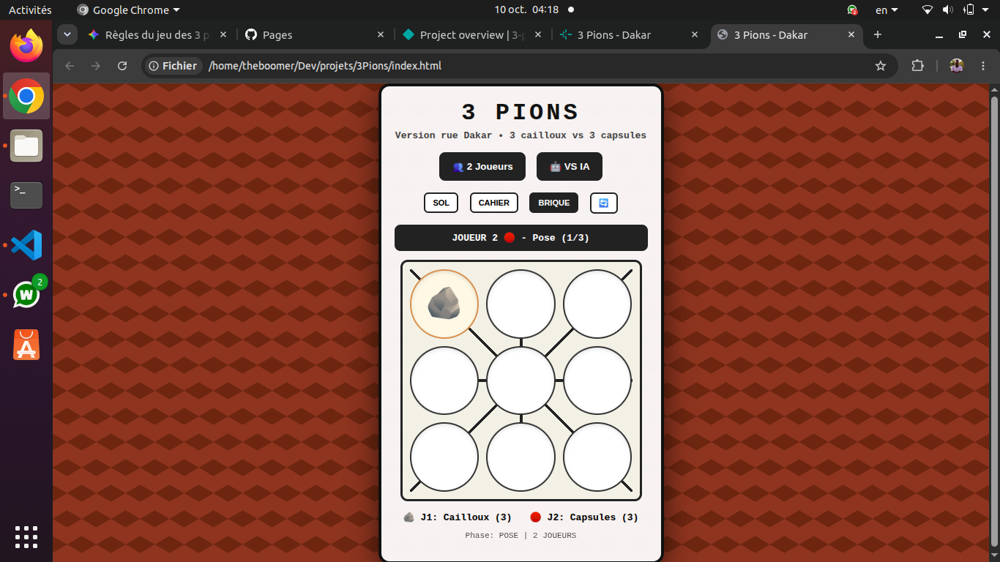
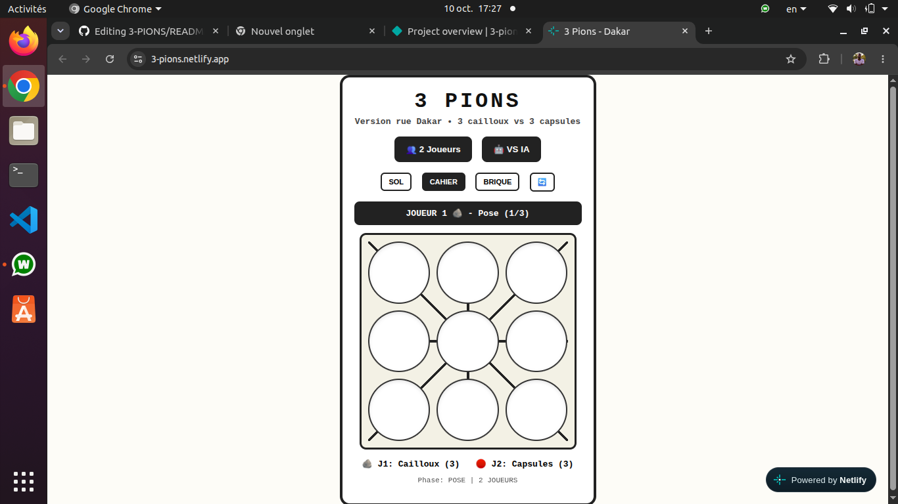
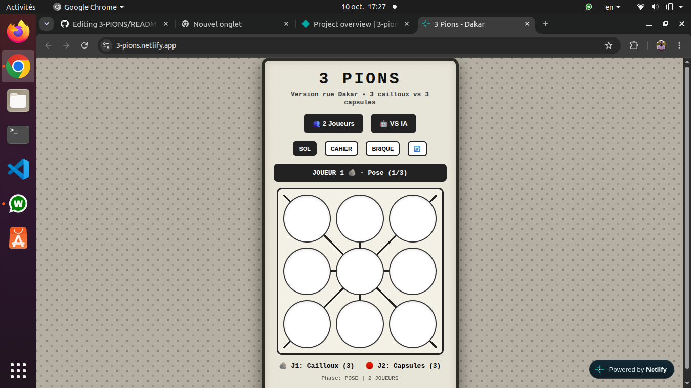

# 3 PIONS - Version Rue Dakar 🪨
On l'appelle Morpion en France. Nous à Dakar, on l'appelle **3 Points**. On le dessine sur le sol à la craie, sur un bout de brique au charbon, ou sur une feuille de cahier en classe.
Jeu traditionnel sénégalais 3 cailloux vs 3 capsules, revisité web. Inspiré des parties jouées dans les rues de Dakar.Ce n'est pas le Morpion classique. C'est la **Version 2 - Version Rue**.


🔗 **Demo live:** https://assiaka98.github.io/3-PIONS/

### 📱 Screenshots

| Thème Brique (rue) | Thème Cahier (papier) |
| :---: | :---: |
|  |  |  |

### 🎮 Features
- 2 Joueurs + VS IA
- Règle locale respectée: 1er coup au centre interdit
- 3 thèmes graphiques: Sol béton, Cahier, Brique street
- 100% Vanilla JS - Responsive mobile-first

### 🛠️ Stack
HTML / CSS / JS - No framework

### 📖 Story
Valoriser un jeu de rue sénégalais en version digitale jouable offline.

# 🪨 3 PIONS - Dakar Edition

> 


### 📜 Règles de la rue (Version 2)

1. **Chacun 3 pions seulement** : Toi = 🪨 Cailloux, Adversaire = 🔴 Capsules
2. **Phase 1 - POSE** : On pose à tour de rôle ses 3 pions
3. **Phase 2 - BOUGÉ** : Après ça, on ne pose plus. On **déplace** un de ses pions vers une case vide à côté (même en diagonale). Premier qui aligne 3 gagne.

Si tu bloques, tu perds. Il faut réfléchir comme au dame.

### 🎮 Jouer


- **Mode**: Joueur vs Ordinateur (IA qui bloque et attaque)
- **Skins**:
    - ☀️ SOL - comme à la cour
    - 📓 CAHIER - comme en classe
    - 🧱 BRIQUE - comme au quartier

### 💻 Tech

- HTML / CSS / JS Vanilla (pas de framework, comme on joue sans matériel)
- Logique d'adjacence pour les déplacements
- IA simple: Gagner > Bloquer > Centre > Coin > Random
- Responsive, marche sur téléphone

### 🚀 Installation

```bash
git clone https://github.com/TON_PSEUDO/3pions-dakar.git
cd 3pions-dakar
# Si tu as Apache:
sudo cp -r * ~/Dev/3points/
# Ouvre http://localhost/3points/
